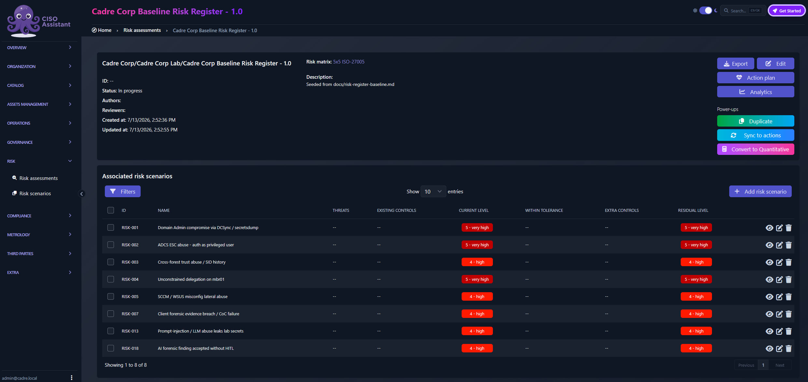

# Risk

<p align="center">
  
</p>

Part of the [CADRE](https://github.com/Ganron007/CADRE) platform — hands-on GRC / CISSP risk practice against a live AD-DFIR estate, with live integration and automated remediation.

> **Plan:** [`docs/plan_v2.md`](docs/plan_v2.md) · **Tracker:** [`CHECKLIST.md`](CHECKLIST.md) · **GRC sinks:** [`docs/grc-sinks.md`](docs/grc-sinks.md) · **Docker:** [`docker/README.md`](docker/README.md) · **Feedback loop:** [`docs/feedback-loop.md`](docs/feedback-loop.md)

---

## Status

| Sprint | State | Date |
|--------|--------|------|
| 0 Hygiene | ✅ | 2026-07-12 |
| 1 Portfolio MVP | ✅ | 2026-07-12 |
| 2 GRC tool sinks | ✅ | 2026-07-13 |
| 3 Domains + adapters | ✅ | 2026-07-13 |
| 4 Exercise quality | ✅ | 2026-07-27 |
| 5 Live adapters | ✅ | 2026-07-27 |
| 6 Feedback loop | ✅ | 2026-07-27 |
| 7 Live integration | ✅ | 2026-07-27 |
| Tests | **8 passed** | 2026-07-13 |

---

## Strategic Alignment

Risk provides tight integration between GRC tools and CADRE platform projects:

| GRC Tool | Integration Target | Framework Focus | Purpose |
|----------|-------------------|-----------------|---------|
| **CISO Assistant** | CADRE main lab | ISO 27001, SOC 2, NIST CSF, GDPR | Classic GRC for AD/SOC estate |
| **VerifyWise** | DarkAI project | EU AI Act, ISO 42001, NIST AI RMF | AI governance for LLM operations |

---

## GRC tool sinks (optional UIs)

Markdown registers are the **source of truth**. These two products are optional Docker UIs for demos / CISSP practice — not Cadre Corp's production GRC.

| | Product | Focus | Lab UI | Practice |
|---|---------|--------|--------|----------|
|  | **[CISO Assistant](https://github.com/intuitem/ciso-assistant-community)** (intuitem) | Classic GRC — ISO 27001, SOC 2, NIST CSF, GDPR | http://localhost:8080 | [`docs/ciso-notes.md`](docs/ciso-notes.md) |
|  | **[VerifyWise](https://github.com/verifywise-ai/verifywise)** | AI governance — EU AI Act, ISO 42001, model inventory | http://127.0.0.1:18080 | [`docs/verifywise-notes.md`](docs/verifywise-notes.md) |

---

### CISO Assistant — classic GRC

Lab: **http://localhost:8080** · Seed: `.\scripts\ciso-seed-baseline.ps1` · Notes: [`docs/ciso-notes.md`](docs/ciso-notes.md)



---

### VerifyWise — AI governance

Lab: **http://127.0.0.1:18080** · Seed: `.\scripts\verifywise-seed-baseline.ps1` · Notes: [`docs/verifywise-notes.md`](docs/verifywise-notes.md)

Login (seeded org): `org-admin@cadre.local` / lab password from seed (`***REMOVED***`)


---

## Quick demos

```powershell
cd C:\STUDY\Github\CADRE-Platform\CADRE-Risk
python -m pip install pyyaml pytest requests elasticsearch
python -m pytest tests/ -q

# Board memo (Sprint 1 — works with zero Docker)
python -m src.board_report --samples samples/findings --out artifacts/board-memo.md

# Live SIEM integration (Sprint 7)
$env:SIEM_MODE="live"
python -m src.board_report --live --siem-url http://127.0.0.1:9200 --siem-index logs-system.security-* --out artifacts/board-memo-live.md

# Cross-platform dashboard (Sprint 6)
python -m src.cross_platform --output artifacts/dashboard.json --html artifacts/dashboard.html

# Approval workflow (Sprint 7)
python -m src.approval_workflow --feedback artifacts/feedback.json --auto-approve --filter

# Ansible integration (Sprint 7)
$env:ANSIBLE_MODE="dry-run"
python -m src.ansible_integration --feedback artifacts/feedback.json --output-dir artifacts/ansible

# GRC UIs — prefer one stack at a time on constrained RAM (see docker/README.md)
.\scripts\ciso-up.ps1
.\scripts\ciso-seed-baseline.ps1          # needs CISO Assistant PAT

.\scripts\verifywise-up.ps1
.\scripts\verifywise-seed-baseline.ps1    # Cadre Corp AI use cases + risks
```

---

## Portfolio artifacts

| Artifact | Path |
|----------|------|
| Enterprise context | `docs/enterprise-context.md` |
| Risk appetite | `docs/risk-appetite-statement.md` |
| Risk register (18) | `docs/risk-register-baseline.md` |
| Control register | `docs/control-register.md` |
| Board memo sample | `docs/examples/board-memo-sample.md` |
| CISSP exercises (87) | `docs/exercises/` (Domains 1-8) |
| Exercise map | `docs/exercises/EXERCISE-MAP.md` |
| Exercise quality audit | `docs/exercise-quality-audit.md` |
| Feedback loop workflow | `docs/feedback-loop.md` |
| **CISO Assistant** practice + screenshot | `docs/ciso-notes.md` · `docs/img/ciso-risk-register.png` |
| **VerifyWise** practice + screenshot | `docs/verifywise-notes.md` · `docs/img/verifywise-ai-risk.png` |

---

## Architecture

```text
CADRE tool outputs (Zeek, Suricata, Nexus, Ansible, Velociraptor, etc.)
        │
        ▼
 adapters → ingest → dedupe → risk_engine
                                      │
                         ┌────────────┴────────────┐
                         ▼                         ▼
                   CISO Assistant              VerifyWise
                   (:8080 HTTP)                (:18080 AI gov)
                   classic GRC                 AI governance
                         │                         │
                         └────────────┬────────────┘
                                      ▼
                              feedback_engine
                                      │
                         ┌────────────┴────────────┐
                         ▼                         ▼
                    approval_workflow      ansible_integration
                    (human-in-the-loop)    (AST-013 remediation)
                         │                         │
                         └────────────┬────────────┘
                                      ▼
                              board_report
                                      │
                         ┌────────────┴────────────┐
                         ▼                         ▼
                    cross_platform           live SIEM
                    (unified dashboard)      (Elasticsearch)
```

**Key Components:**
- **adapters.py**: Convert SARIF, JSON, JSONL to unified findings (Praxis, RevAI, DarkAI)
- **risk_engine.py**: Score risks using 3×3 likelihood × impact matrix
- **feedback_engine**: Generate CADRE lab remediation actions from scored risks
- **approval_workflow.py**: Human-in-the-loop for critical remediation actions
- **ansible_integration.py**: Generate Ansible playbooks for AST-013 automated remediation
- **board_report.py**: Generate executive board memos from scored findings (live SIEM or frozen samples)
- **cross_platform.py**: Unified dashboard combining CISO Assistant and VerifyWise risks

---

## License

MIT — same as the rest of the CADRE platform.  
**CISO Assistant** and **VerifyWise** are third-party products (their licenses apply). VerifyWise is BSL 1.1 (upstream). Tiny marks under `assets/grc/` — see [`assets/grc/README.md`](assets/grc/README.md).
