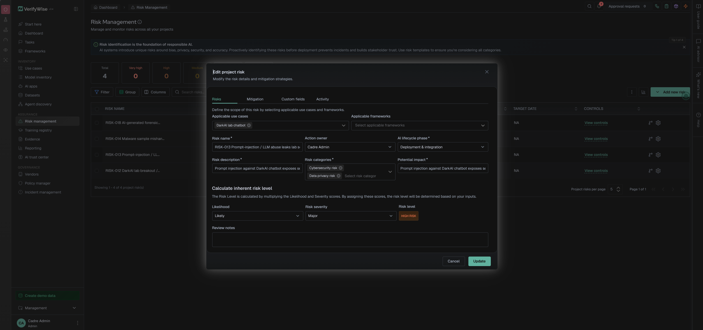

# CADRE-Risk

<p align="center">
  
</p>

**Hands-on GRC lab for the CADRE platform — CISSP risk practice against a real AD/SOC estate.**

> **Plan:** [`plan_v2.md`](plan_v2.md) · **Tracker:** [`CHECKLIST.md`](CHECKLIST.md) · **GRC sinks:** [`docs/grc-sinks.md`](docs/grc-sinks.md) · **Docker:** [`docker/README.md`](docker/README.md)

---

## Status

| Sprint | State |
|--------|--------|
| 0 Hygiene | ✅ |
| 1 Portfolio MVP | ✅ |
| 2 GRC tool sinks | ✅ [CISO Assistant](https://github.com/intuitem/ciso-assistant-community) + [VerifyWise](https://github.com/verifywise-ai/verifywise) |
| 3 Domains + adapters | ✅ |
| Tests | **8 passed** |

---

## GRC tool sinks (optional UIs)

Markdown registers are the **source of truth**. These two products are optional Docker UIs for demos / CISSP practice — not Cadre Corp’s production GRC.

| | Product | Focus | Lab UI | Practice |
|---|---------|--------|--------|----------|
|  | **[CISO Assistant](https://github.com/intuitem/ciso-assistant-community)** (intuitem) | Classic GRC — ISO 27001, SOC 2, NIST CSF, GDPR | http://localhost:8080 | [`docs/ciso-notes.md`](docs/ciso-notes.md) |
|  | **[VerifyWise](https://github.com/verifywise-ai/verifywise)** | AI governance — EU AI Act, ISO 42001, model inventory | http://127.0.0.1:18080 | [`docs/verifywise-notes.md`](docs/verifywise-notes.md) |

---

### CISO Assistant — classic GRC

Lab: **http://localhost:8080** · Seed: `.\scripts\ciso-seed-baseline.ps1` · Notes: [`docs/ciso-notes.md`](docs/ciso-notes.md)


---

### VerifyWise — AI governance

Lab: **http://127.0.0.1:18080** · Seed: `.\scripts\verifywise-seed-baseline.ps1` · Notes: [`docs/verifywise-notes.md`](docs/verifywise-notes.md)

Login (seeded org): `org-admin@cadre.local` / lab password from seed (`***REMOVED***`)



---

## Quick demos

```powershell
cd C:\STUDY\Github\CADRE-Platform\CADRE-Risk
python -m pip install pyyaml pytest
python -m pytest tests/ -q

# Board memo (Sprint 1 — works with zero Docker)
python -m src.board_report --samples samples/findings --out artifacts/board-memo.md

# GRC UIs — prefer one stack at a time on constrained RAM (see docker/README.md)
.\scripts\ciso-up.ps1
.\scripts\ciso-seed-baseline.ps1          # needs CISO Assistant PAT

.\scripts\verifywise-up.ps1
.\scripts\verifywise-seed-baseline.ps1    # Cadre Corp AI use cases + risks
```

---

## Portfolio artifacts

| Artifact | Path |
|----------|------|
| Enterprise context | `docs/enterprise-context.md` |
| Risk appetite | `docs/risk-appetite-statement.md` |
| Risk register (18) | `docs/risk-register-baseline.md` |
| Control register | `docs/control-register.md` |
| Board memo sample | `docs/examples/board-memo-sample.md` |
| CISSP exercises | `docs/exercises/` (Domains 1, 2, 3, 6, 7, 8) |
| **CISO Assistant** practice + screenshot | `docs/ciso-notes.md` · `docs/img/ciso-risk-register.png` |
| **VerifyWise** practice + screenshot | `docs/verifywise-notes.md` · `docs/img/verifywise-ai-risk.png` |

---

## Architecture

```text
CADRE tool samples / SARIF / JSONL
        │
        ▼
 adapters → ingest → dedupe → risk_engine → board_report
                                      │
                         ┌────────────┴────────────┐
                         ▼                         ▼
                   CISO Assistant              VerifyWise
                   (:8080 HTTP)                (:18080 AI gov)
                   classic GRC                 AI governance
```

---

## License

MIT — same as the rest of the CADRE platform.  
**CISO Assistant** and **VerifyWise** are third-party products (their licenses apply). VerifyWise is BSL 1.1 (upstream). Tiny marks under `assets/grc/` — see [`assets/grc/README.md`](assets/grc/README.md).
